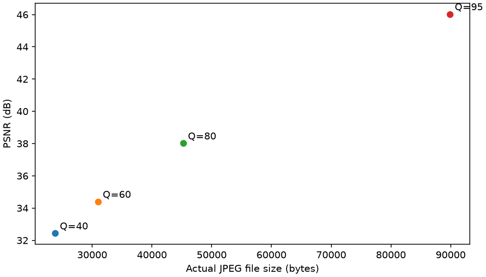
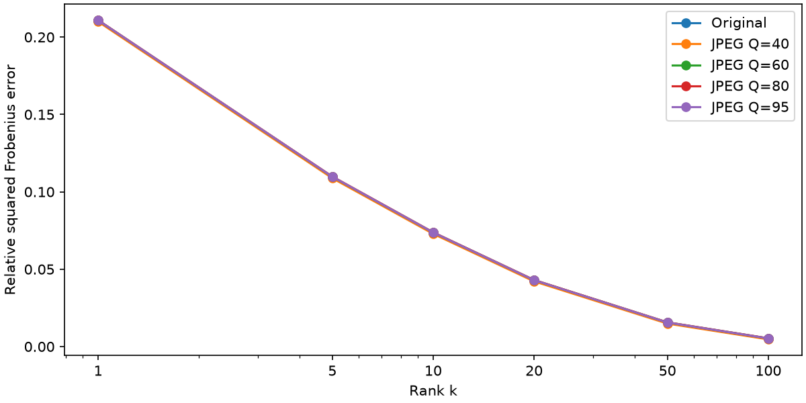
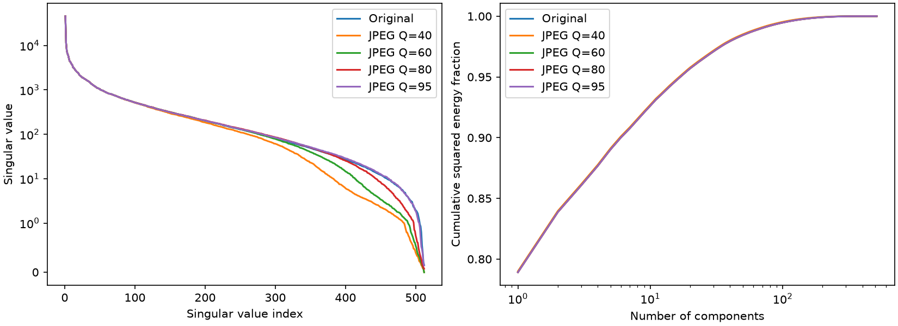
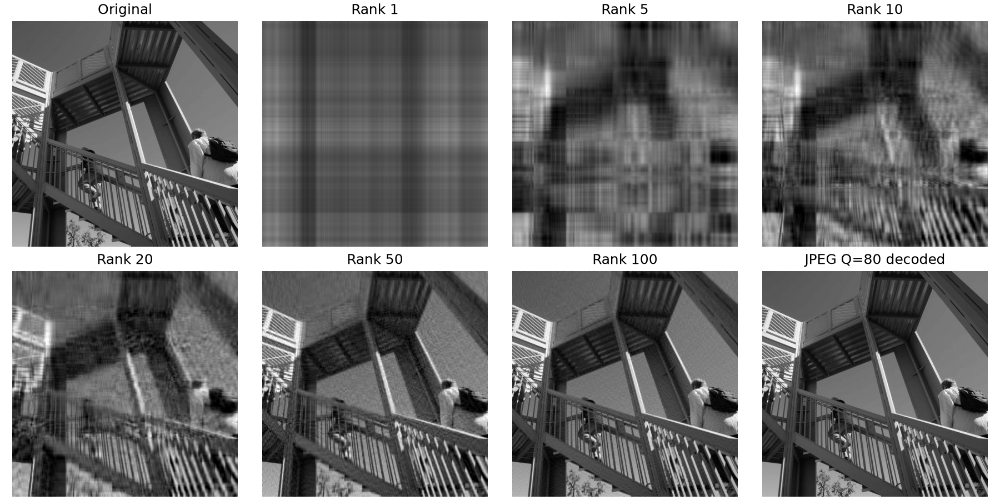
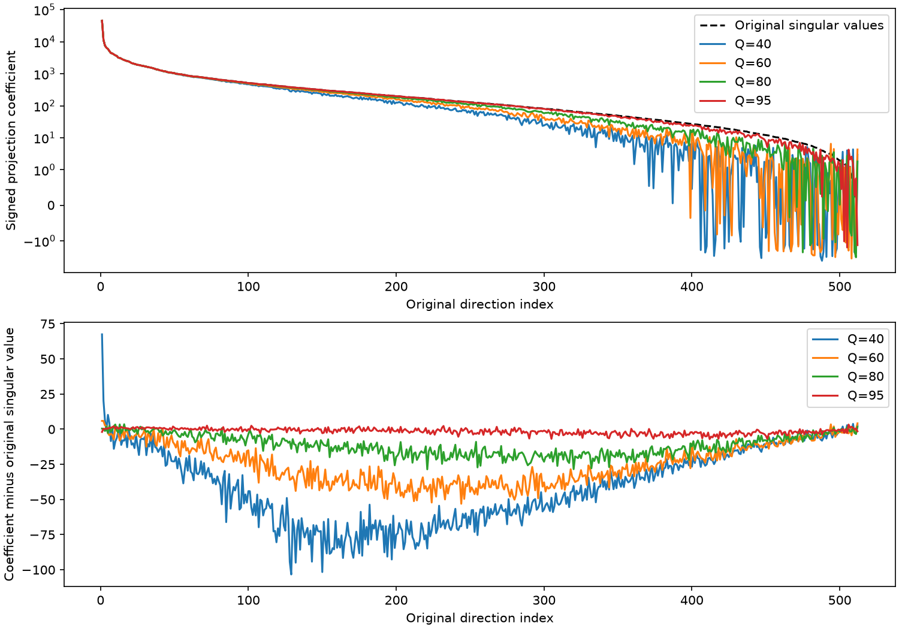

# JPEG 壓縮對影像奇異值與低秩結構之影響分析

正式繳交版與新版圖表見 [PDF](FINAL_REPORT.pdf)。本頁保留已驗收的研究內容與資料連結。

| 封面資訊 | 內容 |
| --- | --- |
| 課程 | 矩陣理論及應用 |
| 學校／系級 | ［待填］ |
| 作者／學號 | 林易辰／B143012007 |
| 授課教師 | ［待填］ |
| 繳交日期 | ［待填］ |

## 摘要

本研究以奇異值分解分析一張灰階影像在 JPEG 編解碼前後的低秩結構。原圖和四張解碼圖分別做全域 SVD，並檢查截斷重建的平方 Frobenius 誤差是否等於尾端奇異值平方和。另將解碼圖投影到原圖的固定秩一方向，量測原始方向上的有號係數變化。結果顯示，四組品質設定的 PSNR 隨 Q 提升，解碼圖自身的 Rank-100 相對平方誤差則未呈單調變化。這兩種指標分別回答像素偏離原圖與解碼圖可近似程度的問題。固定方向的投影另提供各方向的變化，與解碼圖自身的奇異值曲線互補。結論限於本圖與指定編解碼設定。

**關鍵字**　奇異值分解、秩一分解、低秩近似、Frobenius 範數、JPEG

## 一、研究動機與範圍

影像中的像素可排成矩陣，因而能用課堂上的秩、正交投影和矩陣範數討論可近似程度。JPEG 與低秩近似都會改變影像，但兩者採用的分解及誤差基準不同。本研究問三個問題。

1. 截斷 SVD 的最佳性及尾端平方和能否在影像數據上核對？
2. 改變 JPEG 品質設定時，像素失真與解碼影像自身的低秩誤差是否呈現相同趨勢？
3. 固定原圖的秩一方向後，解碼圖沿這些方向的係數如何改變？

研究對象為單張灰階影像及指定編解碼器。浮水印嵌入、提取與抗壓縮測試均在研究範圍之外。

## 二、理論基礎

### 2.1 奇異值分解與最佳低秩近似

以下為 Eckart–Young 最佳低秩近似在 Frobenius 範數下的說明 [1]。實作採 NumPy 的精簡 SVD [3]。以原圖記號表示，$A=\sum_i\sigma_i u_iv_i^{\mathsf T}$，$A_k=\sum_{i\le k}\sigma_i u_iv_i^{\mathsf T}$，且 $\|A-A_k\|_F^2=\sum_{i>k}\sigma_i^2$。以下用一般矩陣 $X$ 推導，因此也適用於每張解碼圖。

對任一實矩陣 $X\in\mathbb R^{m\times n}$，令 $p=\min(m,n)$，精簡 SVD 為 $X=\sum_{i=1}^p s_i a_i b_i^{\mathsf T}$，其中 $s_1\ge\cdots\ge s_p\ge0$。令 $D_i=a_i b_i^{\mathsf T}$。左右奇異向量各自正交歸一，因此 $\langle D_i,D_j\rangle_F=(a_i^{\mathsf T}a_j)(b_i^{\mathsf T}b_j)=\delta_{ij}$。有正權重的項 $s_iD_i$ 秩為一。保留前 $k$ 項得到秩至多 $k$ 的 $X_k$，且由正交性直接得到 $\|X-X_k\|_F^2=\sum_{i>k}s_i^2$。

要說明這個誤差確實最小，任取秩至多 $k$ 的矩陣 $Y$，令 $P$ 為投影到 $Y$ 欄空間的正交投影。因為 $PY=Y$，正交分解給出
$$
\|X-Y\|_F^2=\|(I-P)X\|_F^2+\|PX-Y\|_F^2
\ge \|X\|_F^2-\|PX\|_F^2.
$$
右奇異向量的正交性給出 $\|PX\|_F^2=\sum_i s_i^2 w_i$，其中 $w_i=\|Pa_i\|^2$ 介於 0 與 1，且 $\sum_i w_i\le\operatorname{rank}(P)\le k$（把 $a_i$ 補成完整正交基即可）。因權重上限為 1、總額至多 $k$，將權重優先給最大的 $s_i^2$ 得上界 $\sum_{i\le k}s_i^2$。因此任何 $Y$ 的誤差至少為尾端平方和，而 $X_k$ 達到此下界。此結論適用於整數 $0\le k\le p$。截斷點若切過相等的正奇異值，最優近似可能不唯一。

當 $\|X\|_F>0$，累積平方能量 $E_k=\sum_{i\le k}s_i^2/\sum_i s_i^2$，自身相對平方誤差 $R_k=\|X-X_k\|_F^2/\|X\|_F^2=1-E_k$。兩者使用同一張圖自己的總平方能量。數值核對使用 float64，依各矩陣對照 [rank_errors.csv](../outputs/run-m2/rank_errors.csv) 的 `frobenius_squared`、`tail_squared` 及其正規化欄位。

零矩陣的絕對重建誤差為零，相對平方誤差的定義因分母為零而不適用。本研究的實際影像矩陣皆非零。

### 2.2 JPEG 的區塊 DCT 與量化

JPEG 的 DCT 模式將影像分成局部 $8\times8$ 區塊，對區塊像素做 DCT，再將各頻率係數依量化表的步長除法取整。解碼時以反量化與反轉換近似原像素，取整造成的係數差異會反映在解碼結果中 [2]。本研究用 Pillow 的品質設定控制編碼 [4]，以全影像矩陣做 SVD。全域奇異值索引與局部 DCT 頻率各有不同意義。

## 三、研究方法

原圖 $A$ 為 SciPy 的 `ascent` [5]，即 $512\times512$ 的 8 位元灰階影像。對同一份像素各自以 Q=40、60、80、95 編碼，再重新開啟 JPEG 取得解碼圖 $B_Q$。關閉 progressive 與 optimize，記錄實際位元組數。原圖及解碼圖皆使用 float64 分析，取 $k=1,5,10,20,50,100$ 比較。展示用 Rank-k PNG 由原圖的浮點重建裁切與取整產生，其檔案格式與實際 JPEG 分開。原圖基底只計算一次，四組 Q 共用同一組 $u_i,v_i$ 計算投影。

M2 原始實驗使用 Windows、Python 3.13.14、NumPy 2.4.6、Pillow 12.3.0 與 libjpeg-turbo 3.1.4.1。矩陣尺寸、來源雜湊、參數、版本及數學驗證欄位見 [manifest.json](../outputs/run-m2/manifest.json)。資料來源與原圖授權見 [影像說明](../data/README.md)。

## 四、實驗結果與討論

### 4.1 像素品質、儲存成本及低秩誤差

$\operatorname{MSE}(A,B_Q)=\|A-B_Q\|_F^2/(mn)$。8 位元灰階在 MSE 大於零時採用 $\operatorname{PSNR}=10\log_{10}(255^2/\operatorname{MSE})$，MSE 為零時 PSNR 為無限大。這兩個指標以 $A$ 為基準。$R_k(B_Q)$ 衡量 $B_Q$ 相對自身最佳近似的誤差。

| $Q$ | JPEG 檔案大小（bytes） | MSE | PSNR（dB） | $R_{100}(B_Q)$ |
| ---: | ---: | ---: | ---: | ---: |
| 40 | 23,780 | 37.09696 | 32.43742 | 0.46522% |
| 60 | 30,965 | 23.62286 | 34.39748 | 0.52460% |
| 80 | 45,222 | 10.26691 | 38.01641 | 0.53177% |
| 95 | 89,876 | 1.62239 | 46.02924 | 0.52482% |

前三個量測欄取自 [jpeg_metrics.csv](../outputs/run-m2/jpeg_metrics.csv) 各 `quality_factor` 的 `jpeg_bytes`、`mse`、`psnr_db`。末欄取自 [rank_errors.csv](../outputs/run-m2/rank_errors.csv) 各 `image=jpeg_q<Q>`、`k=100` 的 `relative_squared` 乘 100。原圖同欄 `image=original` 為 0.51677%。

- [檔案大小與 PSNR](../outputs/run-m2/jpeg_metrics.png) 的橫軸是實測 bytes，Q 是標註。這四組設定下，Q 越高，檔案越大、PSNR 越高。較高品質通常使用較細的量化，可能減少解碼像素誤差。本實驗的四組觀察不足以建立一般單調定律。
- [低秩誤差](../outputs/run-m2/rank_errors.png) 顯示每張圖的 $R_k$ 隨 $k$ 增大而下降。固定 $k=100$ 改變 Q，$R_k$ 並不單調。Q=40 自身誤差最低，同時相對原圖的 PSNR 也最低。量化可能減弱部分局部細節，使平方能量更集中於少數全域成分。這是與觀察相容的解釋，本實驗未逐一辨識 DCT 係數對全域譜的因果貢獻。
- [頻譜與累積平方能量](../outputs/run-m2/spectra.png) 顯示各圖譜的前段接近，尾段差異較明顯。例如 `i=400` 的 `sigma` 由原圖的 27.10575 變為 Q=40 的 6.09311，Q=95 則為 28.75731。因此不能概括為所有奇異值都縮小。原圖及 Q=40 的前 100 項平方能量分別為 99.48323% 與 99.53478%，與各自的 $1-R_{100}$ 一致。來源為 [spectrum.csv](../outputs/run-m2/spectrum.csv) 中 `image=original/jpeg_q40/jpeg_q95` 的 `i=400, sigma`，以及 `image=original/jpeg_q40` 的 `i=100, cumulative_energy`。
- [重建拼圖](../outputs/run-m2/reconstructions.png) 中，隨 $k$ 提高，樓梯與欄杆的輪廓逐漸清楚。拼圖最後一格是 Q=80 解碼影像，其餘標示 Rank 的格子是原圖截斷重建。用 [rank_errors.csv](../outputs/run-m2/rank_errors.csv) 的 `image=original`、各 `k` 的 `relative_squared` 核對浮點誤差，視覺展示用 PNG 的裁切與取整不參與此誤差。




*圖 1．橫軸為實際 JPEG 位元組數，縱軸為相對原圖的 PSNR，點旁標註品質因子。*




*圖 2．橫軸為保留秩 k（對數刻度），縱軸為每張矩陣自身的相對平方 Frobenius 誤差。*




*圖 3．左圖為奇異值索引與奇異值（對稱對數尺度），右圖為保留項數（對數刻度）與各矩陣的累積平方能量占比。*




*圖 4．原圖、六組原圖 Rank-k 重建與 Q=80 解碼影像。各圖以相同灰階範圍展示。*


### 4.2 固定原圖秩一方向的有號投影

令 $A$ 的奇異向量與奇異值為 $u_i,v_i,\sigma_i$。因 $u_iv_i^{\mathsf T}$ 的 Frobenius 範數為 1，
$$
c_i(Q)=\langle B_Q,u_i v_i^{\mathsf T}\rangle_F=u_i^{\mathsf T}B_Q v_i,\qquad
\Delta_i(Q)=\langle B_Q-A,u_i v_i^{\mathsf T}\rangle_F.
$$
代入 $B_Q=A$ 得 $c_i=\sigma_i$。四組 Q 都使用原圖同一組方向，$c_i$ 帶正負號；$B_Q$ 的奇異值則由其自身 SVD 得到，非負且重新排序。固定方向只取原圖基底中配對的 $i,i$ 項，未涵蓋跨方向成分。這些係數不宜作為資訊保留率。若原圖有重複奇異值，對應子空間可選不同正交基底，單一方向的 $c_i$ 會依基底而變。

[投影圖](../outputs/run-m2/projections.png) 上半部比較有號係數與原圖奇異值，下半部展示差值。以 `i=200` 為例，Q=40 的 $\Delta_i=-75.10047$，Q=95 為 $-1.43469$。Q=95 在 `i=512` 的 $c_i=-1.35063$，而原圖同方向 $\sigma_i=0.15024$，可具體說明投影係數為何能帶負號。來源為 [projections.csv](../outputs/run-m2/projections.csv) 的 `quality_factor=40/95, i=200, delta` 及 `quality_factor=95, i=512, coefficient/original_sigma`。




*圖 5．兩圖橫軸均為原圖方向索引。上圖縱軸為有號係數（對稱對數尺度），虛線是原圖奇異值。下圖縱軸為係數減原圖奇異值。*


## 五、結論、限制與未來工作

截斷 SVD 在秩至多 k 的限制下達到最小 Frobenius 誤差，殘差平方可從未保留奇異值的平方和核對。Q=40 的解碼圖在本實驗較容易以 Rank-100 近似，同時相對原圖有較大的像素失真。自身低秩誤差反映平方能量分布，無法作為原圖資訊保留率。原圖固定方向投影揭示某些係數增減及符號變化，可與解碼圖自身的奇異值分布並讀。

樣本只有一張灰階影像，PSNR 衡量像素差異，未量測視覺感受或語意資訊。結果受圖像內容與 JPEG 參數影響，無法據此推廣至其他影像。未來可用不同紋理的影像檢驗低秩誤差的趨勢。若另行研究浮水印，應先建立固定的嵌入與提取方法及未壓縮對照，再比較 JPEG 後的位元錯誤率和嵌入失真。

## 參考文獻

1. Eckart, C., & Young, G. (1936). The approximation of one matrix by another of lower rank. *Psychometrika*, 1(3), 211–218. [DOI](https://doi.org/10.1007/BF02288367)
2. ITU-T. (1992). *Recommendation T.81: Information technology – Digital compression and coding of continuous-tone still images – Requirements and guidelines*. [ITU-T 標準](https://www.itu.int/rec/T-REC-T.81/en)
3. NumPy Developers. *numpy.linalg.svd*. [NumPy 文件](https://numpy.org/doc/stable/reference/generated/numpy.linalg.svd.html)
4. Pillow Contributors. *Image file formats: JPEG*. [Pillow 文件](https://pillow.readthedocs.io/en/stable/handbook/image-file-formats.html#jpeg)
5. SciPy Developers. *scipy.datasets.ascent*. [SciPy 文件](https://docs.scipy.org/doc/scipy/reference/generated/scipy.datasets.ascent.html)

## 附錄　重現步驟

從專案根目錄執行以下 PowerShell 命令。使用尚未存在的輸出目錄，保留 M2 原始存檔。

```powershell
py -3.13 -m venv .venv-final
$python = '.\.venv-final\Scripts\python'
& $python -m pip install -r requirements.txt
& $python -m pip check
Get-FileHash data/ascent.png -Algorithm SHA256
& $python -m experiment --input data/ascent.png --output-dir outputs/run-m4-local --qualities 40 60 80 95
& $python -m pytest -v
```

輸入 PNG 的 SHA-256 應為 `3b7cae537bc09699016556df746184a2376083244ae375a2740ee7157970ebf3`。以新舊 manifest 核對輸入、JPEG 設定及版本。跨平台、JPEG 函式庫或 BLAS 執行方式可能影響檔案位元組或浮點末位。各次執行應以自己的解碼像素核對 MSE、PSNR、頻譜與投影，並以既定容差驗證數值結果。
